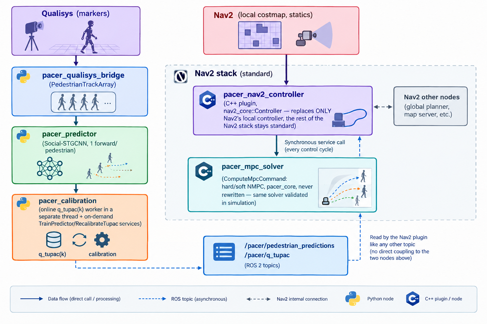

# pacer-tupac-code-ros

ROS2 (colcon workspace) port of the MPC-TUPAC controller validated in
simulation, with **direct** integration into Nav2 (`nav2_core::Controller`
plugin) and pedestrian ground truth from **Qualisys** (motion capture,
marker helmet — see vault note "Sim2Real - dettagli implementativi",
section "aggiornamento — ground truth pedoni per la campagna sperimentale
attuale").

Implements the architecture described in the vault note "Sim2Real -
dettagli implementativi": training and calibration **on demand** (never
implicit in the online node), an online node that reads the predicted
trajectory, computes `q_tupac(k)` online and applies the constrained NMPC
returning the control input, and Nav2 for static obstacles (via the local
costmap, as a soft cost) while the project's own module handles dynamic
pedestrians (hard constraint or soft cost, selectable — `controller_mode`).

## What was NOT done here (stated honestly, not by omission)

- **Not built/tested with `colcon build`**: this environment has no
  ROS2/colcon installed. All the **pure-Python** logic (`pacer_core`, and
  therefore also the three nodes `pacer_predictor`/`pacer_calibration`/
  `pacer_mpc_solver` that call into it) was however **actually run and
  verified** outside ROS2 in this environment (import, training on a mini
  dataset, D_cal construction, prediction, hard and soft NMPC with a
  pedestrian obstacle and a static obstacle together — see "What was
  verified here" at the bottom). The C++ Nav2 plugin
  (`pacer_nav2_controller`) is written against the standard
  `nav2_core::Controller` interface but **not compiled** here — it needs
  `colcon build` on a machine with ROS2 (Humble/Iron/Jazzy) + Nav2
  installed before use.
- **Assumed Qualisys message**: `pacer_qualisys_bridge` assumes the
  Qualisys driver publishes `mocap_msgs/msg/RigidBodies` (the convention
  used by the mocap4ros2/qualisys_ros2 ecosystem). If the installed driver
  uses a different package/message, only `_on_rigid_bodies()` in that file
  needs adapting — the rest of the node (buffering, resampling at dt_out,
  publishing) stays unchanged.
- **Calibration still simulated**: `pacer_core/calibration_offline.py`
  builds D_cal from SFM simulation (same engine as the development
  pipeline), not from real Qualisys logs — consistent with the current
  state declared in the Sim2Real note (no real data used to recalibrate
  yet). `build_dcal_from_qualisys_log()` is the extension point already
  laid down for when that becomes necessary.
- **Uniform static-obstacle weight**: `w_static` is a single parameter of
  the `pacer_mpc_solver` node, not per-obstacle — enough for a first
  working version, but a "hard" obstacle (a wall) and a "soft" one (a
  waste bin) today weigh the same in the cost.
- **No testing on real hardware, no latency characterization on the target
  embedded computer** — see the 3-phase rollout plan in the Sim2Real note
  (shadow mode -> soft at low speed -> hard constraint) before any real
  use.

## Architecture



The four Python nodes (`pacer_qualisys_bridge`, `pacer_predictor`,
`pacer_calibration`, `pacer_mpc_solver`) are launched together by
`pacer_bringup/launch/pacer_bringup.launch.py`. The Nav2 plugin registers
into the existing `controller_server` — see
`pacer_bringup/config/nav2_params_snippet.yaml` for how to point it there
(ONLY the local controller changes; planner/costmap/recovery stay the
standard Nav2 stack).

## Packages

| Package                 | Type                                 | Content                                                                                                                                                                                                                                                   |
| ----------------------- | ------------------------------------ | --------------------------------------------------------------------------------------------------------------------------------------------------------------------------------------------------------------------------------------------------------- |
| `pacer_msgs`            | ament_cmake (rosidl)                 | Shared messages/services (`PedestrianTrack[Array]`, `PedestrianPrediction[Array]`, `QTupacSnapshot`, `StaticObstacle`, `TrainPredictor.srv`, `RecalibrateTupac.srv`, `ComputeMpcCommand.srv`).                                                            |
| `pacer_core`            | ament_python (pure library, no ROS2) | Unicycle NMPC hard/soft, constant-area pedestrian Gaussians, TUPAC calibration (online + offline), Social-STGCNN predictor, SFM engine for D_cal, static-obstacle cost — **the same code validated in simulation**, reorganized as an importable package. |
| `pacer_qualisys_bridge` | ament_python                         | Qualisys (`mocap_msgs/RigidBodies`) -> `PedestrianTrackArray`, sampled at dt_out=0.4s.                                                                                                                                                                    |
| `pacer_predictor`       | ament_python                         | `PedestrianTrackArray` -> `PedestrianPredictionArray` (Social-STGCNN inference).                                                                                                                                                                          |
| `pacer_calibration`     | ament_python                         | Online update of `q_tupac(k)` (separate thread) + on-demand `TrainPredictor`/`RecalibrateTupac` services.                                                                                                                                                 |
| `pacer_mpc_solver`      | ament_python                         | `ComputeMpcCommand` service: one NMPC cycle, hard or soft, calling `pacer_core` directly.                                                                                                                                                                 |
| `pacer_nav2_controller` | ament_cmake (C++)                    | `nav2_core::Controller` plugin — bridge between Nav2 and `pacer_mpc_solver`, static obstacles from the local costmap.                                                                                                                                     |
| `pacer_bringup`         | ament_cmake                          | Launch file + parameters + `nav2_params.yaml` snippet.                                                                                                                                                                                                    |

## Build (on a machine with ROS2 + Nav2 installed, not verified here)

```bash
cd pacer-tupac-code-ros
colcon build --symlink-install
source install/setup.bash
```

## Quick start on the real robot (NUC)

Everything below runs inside the container. The defaults are ready to use:
the predictor and a simulated D_cal ship in `models/`, the `standard` calibrator
is selected, and the safety filter has `away_only: true`.

1. **Once:** clone the repo and connect the NUC to the WiFi where the QTM PC
   is. Set `host_name` (QTM PC's IP) in
   `mocap4ros2_qualisys/qualisys_driver/config/qualisys_driver_params.yaml`;
   see `mocap4ros2_qualisys/README.md`. Then build the image:

       docker compose -f docker-compose.nuc.yml build
       docker compose -f docker-compose.nuc.yml up -d

2. **In `pacer/pacer_bringup/config/pacer_params.yaml`:**
   - `pedestrian_ids` must list the people's rigid-body names in QTM;
   - check the robot limits (`v2_a_acc`, `v2_a_dec`, `a_dec` of the safety
     filter) against the real car.
3. **Shell 1, the Qualisys driver:**

       docker compose -f docker-compose.nuc.yml exec pacer bash
       ros2 launch qualisys_driver qualisys.launch.py

   **Localization comes from Qualisys:**
   - The bridge publishes `map -> odom` from the car's rigid body, so the map
     frame is the QTM frame.
   - Do **not** run AMCL or SLAM in the Nav2 bringup. The base odometry
     (`odom -> base_link`) stays as it is.
   - Measure `body_to_base` in `pacer_params.yaml`: the offset between the QTM
     rigid body and `base_link`.
   - Without wheel odometry, set `odom_frame: ""` and the bridge publishes
     `map -> base_link` directly.

4. **Shell 2, PACER** (`robot_body` is the car's rigid-body name in QTM;
   `run_name:=auto` writes the CSV logs to `./bags/runs/run_<date>/`):

       ros2 launch pacer_bringup pacer_bringup.launch.py robot_body:=omnicar run_name:=auto

   Then start Nav2 for the car, with the snippet in
   `pacer_bringup/config/nav2_params_snippet.yaml`. The 2D lidar on `/scan`
   is filtered by `pacer_pedestrian_filter`: the costmaps read
   `/scan/pedestrian_filtered` (`LaserScan`, `inf_is_valid: true`; full
   example in the snippet). The controller output goes
   to `/cmd_vel_nav`; the safety filter publishes `/cmd_vel`.
5. **Real D_cal:**
   - Record a run with the car moving among people (teleoperated or on a
     mission, `run_name:=auto`).
   - Build the D_cal, then relaunch with it:

         /home/ros/src/tools/make_dcal_real.sh run_<date> omnicar      # -> /models/cal_real.npz
         ros2 launch pacer_bringup pacer_bringup.launch.py robot_body:=omnicar run_name:=auto calibration:=/models/cal_real.npz

Launch arguments: `robot_body`, `run_name`, `calib_preset`, `calibration`,
`model`, `pedestrian_filter` (`false` if the car has no lidar), `params_file`,
`calibrator_file`, `log_dir`.

## Usage

1. **On-demand training** of the predictor (service, never automatic):
   `ros2 service call /pacer/train_predictor pacer_msgs/srv/TrainPredictor "{scenario: open_field, n_runs_train: 6000, n_peds_scene: 10, epochs: 10, lr: 0.005, hidden_dim: 32, seed: 42, out_model_path: '/path/predictor.pt'}"`
2. **On-demand calibration** (D_cal + `q_tupac(k)` warm-start):
   `ros2 service call /pacer/recalibrate_tupac pacer_msgs/srv/RecalibrateTupac "{model_path: '/path/predictor.pt', scenario: open_field, n_runs_cal: 1500, n_peds_scene: 10, seed: 777, alpha: 0.1, delta: 0.1, h_param: 12, out_calibration_path: '/path/calibration'}"`
3. **Start the TUPAC module**: `ros2 launch pacer_bringup pacer_bringup.launch.py params_file:=<pacer_params.yaml with model_path/calibration_path filled in>`
4. **Start Nav2** with a `nav2_params.yaml` that includes the snippet in `pacer_bringup/config/nav2_params_snippet.yaml` (controller_server -> `PacerController`).

### Running on an Intel NUC (no NVIDIA GPU)

`docker-compose.yml` needs an NVIDIA GPU and the NVIDIA Container Toolkit.
On a NUC, use `docker-compose.nuc.yml` instead.
- **What is the same:** container name (`pacer_tupac`), bind mounts (`./pacer`,
  `./mocap4ros2_qualisys`, `./bags`) and the `pacer_models` volume.
- **What changes:**
  - the image is CPU-only (`ubuntu:22.04` base, CPU torch wheels, tag
    `pacer-tupac-code-ros:nuc`);
  - the container restarts on boot (`restart: unless-stopped`).

```bash
docker compose -f docker-compose.nuc.yml build      # once (or after Dockerfile changes)
docker compose -f docker-compose.nuc.yml up -d
docker compose -f docker-compose.nuc.yml exec pacer bash
```

The PACER nodes never use the GPU; models are loaded with
`map_location="cpu"`. The only thing to tune on the NUC is the MPC time
budget:
- measure the solve time with `python3 /home/ros/src/tools/mpc_jit_check.py` (inside the container);
- if needed, set `v2_jit: true` and adjust `v2_t_budget` / `v2_deadline` in
  `pacer_params.yaml`.

The repo is meant for the real robot only. The Gazebo simulation
(`pacer_sim`, with the vendored `jo_description` / `jo_navigation`) was
removed on 2026-11-24 and is still in the git history (commit `98631b9`)
if it is ever needed again.

### Qualisys driver

`mocap4ros2_qualisys/` is aligned with
[qualisys_docker](https://github.com/giacomotambe/qualisys_docker):
- the driver streams every QTM frame (full capture rate, not 10 Hz);
- the driver parameters use the right port key;
- `scripts/record_mocap.sh` records rigid bodies into `./bags`.

It runs in the same container with the same volumes, so no extra image is
needed. See `mocap4ros2_qualisys/README.md`.

### Choosing the calibrator (config file)

The conformal calibrator is selected in its own file,
`pacer_bringup/config/calibrator.yaml`. The launch file loads it after
`pacer_params.yaml`, so its values take precedence.

```yaml
pacer_calibration:
  ros__parameters:
    calib_preset: "standard"      # standard | conservative | legacy | static | custom
    calib_method: "xbet"          # only with custom: none|static|aci|kl|bet|fbet|xbet
    calib_method_long: "static"   # only with custom: calibrator for k>=2 ("" = same as k=1)
    alpha_far: 0.1                # only with custom: alpha at k=1 for people farther than d_near
```

| preset | k=1 (safety guarantee) | k>=2 (planning only) | far group at k=1 |
|---|---|---|---|
| `standard` (default) | `xbet`, mixture-of-bets BET with capped capital | `static`, Mondrian quantile of D_cal | alpha 0.1 |
| `conservative` | `fbet`, capped BET with a single bet | `static` | alpha 0.1 |
| `legacy` | `bet` at every offset (previous standard) | `bet` | same as near group |
| `static` | split-conformal quantile, no anytime guarantee (baseline) | `static` | same as near group |

The closed-loop results behind each preset come from simulation with 20
people, with "stress" meaning unpredictable pedestrians. α₁ = 1.67% is the
risk allowed for near pedestrians at k=1, the quantity the guarantee rests on.
- `standard`: near-group miss at k=1 under stress is 1.48%, below α₁.
- `conservative`: 1.29%, with k=1 regions about 7% larger.
- `standard` and `conservative` assume `mondrian_group: "dist"`.

You can also pick a preset at launch time, or point to a different file:

    ros2 launch pacer_bringup pacer_bringup.launch.py calib_preset:=conservative
    ros2 launch pacer_bringup pacer_bringup.launch.py calibrator_file:=/path/my_calibrator.yaml

Recommended rollout on real hardware: shadow mode -> soft at low speed ->
hard constraint, exactly as in vault note Sim2Real §4 — not automated
here, it is an operating procedure for whoever uses this code.

## What was verified here (without ROS2 installed)

The entire `pacer_core` part (pure Python, no ROS2 dependency) was
actually run in this environment, not just written:

- package import and hard/soft NMPC wiring with a pedestrian obstacle
  AND a static obstacle together (new functionality of this port) — both
  solvers converge, the reported status is as expected.
- `predictor_utils.predict_window` on a window built by
  `window_builder.build_window` (the same function used by the
  `pacer_predictor` node) — correct output shapes (12,2)/(12,2,2).
- `OnlineCalibrationWorker` (thread, submit/snapshot/stop) — the same
  class used by the `pacer_calibration` node, unchanged behavior.
- the full offline calibration pipeline: SFM simulation -> windows ->
  prediction -> pool -> TUPAC quantile -> `.npz` save/load — the same one
  called by the `RecalibrateTupac` service.
- predictor training on a mini dataset (a few runs, 1 epoch) — the same
  function called by the `TrainPredictor` service.

Not verified (requires a full ROS2/Nav2 environment): compiling the C++
plugin, actual inter-node communication over topics/services, the
plugin's behavior inside Nav2's `controller_server`, integration with a
real Qualisys driver.

## Links

- Vault note "MPC Uniciclo sui Pedoni - Vincolo Rigido vs Costo Soft
  (confronto)" — the two controllers (`pacer_core.unicycle_nmpc`/
  `unicycle_nmpc_soft`) validated in simulation, reused here unchanged.
- Vault note "Sim2Real - dettagli implementativi" — problem, architecture
  and criticalities of this port (this code is its implementation).
